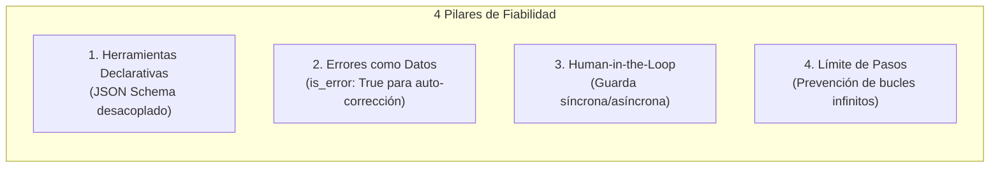
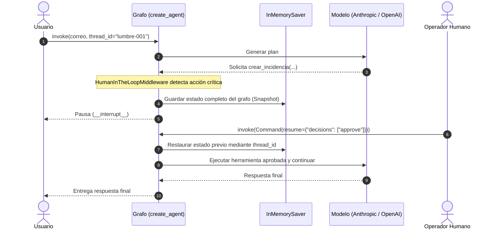
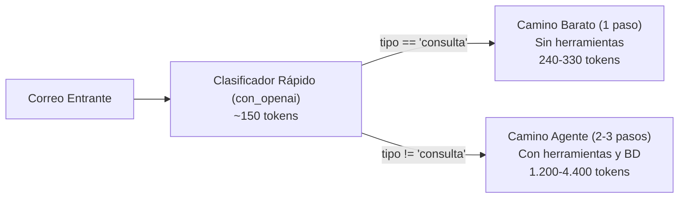

# Práctica Sesión 3: Arquitectura, Experimentación, Abstracción y Optimización de Agentes Autónomos

**Autor:** Rubén  
**Materia:** Inteligencia Artificial Avanzada / Sistemas Agénticos  
**Entorno y Modelos:** Python 3.12, `anthropic/claude-haiku-4.5` (vía OpenRouter Messages API), LangChain 1.x / LangGraph, OpenAI Responses API  

---

## Resumen Ejecutivo

El presente informe documenta el desarrollo, evaluación y optimización de un sistema agéntico orientado a la resolución automatizada de correos técnicos y comerciales para la empresa **Tostadero Retiro S.L.**

A lo largo de cuatro fases progresivas se investigan los compromisos fundamentales en el diseño de agentes:
1. **P1 (Construcción desde Cero):** Implementación de una arquitectura agéntica de bucle cerrado (*ReAct pattern*) sobre la Messages API de Claude, introduciendo cuatro mecanismos de fiabilidad: esquemas declarativos desacoplados, tratamiento de excepciones como datos (`is_error: True`), intercepción humana supervisada (*Human-in-the-Loop*) y límite de seguridad de pasos (`max_pasos`).
2. **P2 (Evaluación de Resiliencia y Casos Límite):** Ejecución de 5 experimentos controlados para evaluar la adherencia a instrucciones del sistema, la inducción de llamadas espurias (*tool eagerness*), la prevención de alucinaciones de claves primarias y los efectos de consistencia de datos ante cortes prematuros del bucle.
3. **P3 (Abstracción en Frameworks - LangChain 1.x / LangGraph):** Reescritura del agente bajo el paradigma de grafos de estado con `create_agent`. Análisis crítico de la gestión de pausas asíncronas mediante *Checkpointers* (`InMemorySaver`), middleware declarativo y compensaciones (*trade-offs*) entre abstracción y observabilidad.
4. **P4 (Optimización de Flujo - Workflow delante del Agente):** Implementación de un clasificador previo determinista mediante modelos ligeros que bifurca el tráfico. Se demuestra empíricamente un **ahorro de hasta un 38,2% en tokens totales (y un 91,8% en consultas de catálogo)** respecto al enfoque 100% agéntico.

```mermaid
flowchart TD
    Inicio([Correo Entrante del Cliente]) --> Clasificador["Clasificador Estructurado (con_openai / Pydantic)"]
    
    Clasificador -->|tipo == 'consulta'| CaminoBarato["Camino Barato y Rápido (LLM directo sin tools)<br/>gpt-5.4-nano / gemini-3.8-flash"]
    Clasificador -->|tipo in ['pedido', 'incidencia', 'mixto']| CaminoAgente["Camino Agéntico Complejo (Agente Autónomo)<br/>Claude Haiku 4.5 + Herramientas BD"]
    
    CaminoBarato --> RespDirecta([Respuesta Inmediata al Cliente])
    
    subgraph BucleAgente ["Bucle del Agente (max_pasos = 8)"]
        Decidir{"¿Requiere herramientas?<br/>(stop_reason == 'tool_use')"}
        Ejecutar["Ejecutar Herramientas en BD<br/>(buscar_cliente, consultar_pedidos...)"]
        Aprobacion{"¿Acción crítica?<br/>(crear_incidencia)"}
        Humano["Intervención Humana<br/>(Aprobación [s/N])"]
        Retro["Inyectar tool_result<br/>(is_error: bool)"]
    end
    
    CaminoAgente --> Decidir
    Decidir -->|Sí| Aprobacion
    Aprobacion -->|Requiere Aprobación| Humano
    Aprobacion -->|No crítica| Ejecutar
    Humano -->|Aprobado| Ejecutar
    Humano -->|Rechazado| Retro
    Ejecutar --> Retro
    Retro --> Decidir
    Decidir -->|No (end_turn)| RespFinal([Respuesta Final al Cliente])
    Decidir -->|Excede max_pasos| Fallback([Escalado Seguro a Operador Humano])
```

---

## Índice
1. [P1. Un Agente desde Cero: Arquitectura y Mecanismos de Control](#p1-un-agente-desde-cero-arquitectura-y-mecanismos-de-control)
2. [P2. Experimentos con el Agente: Comportamiento ante Casos Límite](#p2-experimentos-con-el-agente-comportamiento-ante-casos-límite)
3. [P3. El Mismo Agente con LangChain: Comparativa Arquitectónica](#p3-el-mismo-agente-con-langchain-comparativa-arquitectónica)
4. [P4. Enrutador: Workflow delante del Agente y Benchmark de Ahorro](#p4-enrutador-workflow-delante-del-agente-y-benchmark-de-ahorro)
5. [Consideraciones de Seguridad, Idempotencia y Producción](#consideraciones-de-seguridad-idempotencia-y-producción)
6. [Conclusiones](#conclusiones)

---

## P1. Un Agente desde Cero: Arquitectura y Mecanismos de Control

El script `s3_agente.py` implementa la clase `Agente`, que gestiona el ciclo completo de interacción con la Messages API de Claude sin la sobrecarga de frameworks intermedios.

### 1. Las 4 Mejoras Clave del Agente

A diferencia de un simple bucle reactivo de *function calling*, el diseño incorpora cuatro pilares de ingeniería de fiabilidad para entornos de producción:



1. **Herramientas Declarativas (`Herramienta`):**  
   Desacopla la definición del esquema JSON Schema que recibe el LLM de la función Python que implementa la lógica de negocio. Permite tipar metadatos adicionales como `requiere_aprobacion`. En `_definiciones()`, se adapta la estructura para cumplir la especificación de Anthropic (`input_schema`).
2. **Errores Devueltos como Datos (`is_error: True`):**  
   Si una herramienta falla (por argumentos no conformes, registros no encontrados o excepciones de BD), la función captura el error en un bloque `try/except` y genera un bloque `tool_result` estructurado con `"is_error": True`. Esto evita la caída del proceso (*crash*) y proporciona al modelo retroalimentación en su propio contexto para que formule una estrategia alternativa en el siguiente turno.
3. **Aprobación Humana (*Human-in-the-Loop*):**  
   Las acciones con efectos secundarios permanentes en la base de datos (como `crear_incidencia`) se declaran sensibles. Antes de la invocación, el despachador `_ejecutar` detiene el flujo solicitando validación explícita al operador (`[s/N]`). Si el operador rechaza la acción, se inyecta un error instructivo: `"Un operador humano ha rechazado esta acción. No la repitas."`.
4. **Límite de Pasos y Parada Segura (`max_pasos`):**  
   Control estricto sobre el bucle `for paso in range(1, self.max_pasos + 1)`. Previene el desbordamiento de costes por bucles degenerativos o estados oscilantes. Si se agota el presupuesto de pasos, se aborta limpiamente devolviendo un mensaje de derivación a personal humano.

### 2. Ejecución y Traza del Caso Base

Se configuró el entorno con la base de datos relacional `tostadero.db` (SQLite) y credenciales en `.env`. Se procesó el correo oficial de prueba:

> *"Buenas, os escribo del Restaurante Lumbre. La cafetera de dos grupos no calienta y hoy no podemos servir cafés. ¿Además, cuándo llega el pedido pendiente?"*

**Traza de ejecución en consola:**
```text
[paso 1] razonamiento visible: Voy a ayudarte. Primero te busco en el sistema para identificarte correctamente y luego consulto tu 
[paso 1] buscar_cliente({'texto': 'Restaurante Lumbre'}) -> [{'id': 2, 'nombre': 'Restaurante Lumbre', 'tipo': 'restaurante', 'distrito': 'Chamberí'}]
[paso 2] razonamiento visible: Perfecto, ya te tengo localizado. Ahora voy a registrar la avería de la cafetera (que es crítica por
  ¿Aprobar crear_incidencia({'cliente_id': 2, 'maquina': 'MAQ-002', 'descripcion': 'Cafetera de dos grupos no calienta. Cliente no puede servir cafés.', 'prioridad': 'alta'})? [s/N] s
[paso 2] crear_incidencia(...) -> {'id': 4, 'estado': 'abierta'}
[paso 2] consultar_pedidos({'cliente_id': 2}) -> [{'id': 1003, 'fecha': '2026-09-28', 'estado': 'pendiente', 'total': 496.4}]

Respuesta final al cliente:
Buenas, Restaurante Lumbre:
✅ Avería registrada: He abierto una incidencia (ID #4) con prioridad ALTA para vuestra cafetera de dos grupos...
📦 Pedido pendiente: Tenéis un pedido (ID #1003) por 496,40 € con fecha de 28 de septiembre en estado pendiente...
```

*Análisis:* El modelo requirió 3 pasos efectivos. En el paso 1 resolvió la clave foránea `cliente_id = 2`. En el paso 2 planificó concurrentemente la mutación de la BD (`crear_incidencia`) y la lectura (`consultar_pedidos`). La guarda humana interceptó la creación y, tras la aprobación, en el paso 3 redactó la respuesta integrando ambos contextos.

---

## P2. Experimentos con el Agente: Comportamiento ante Casos Límite

Para validar la robustez del agente frente a fallos operacionales y manipulaciones de esquemas y prompts, se realizaron 5 experimentos sistemáticos:

| Nº | Experimento | Modificación Introducida | Observación Principal | Veredicto |
|:--:|---|---|---|:---:|
| **1** | **Correo de ejemplo** | Configuración base | Secuencia ordenada (búsqueda $\rightarrow$ mutación + lectura $\rightarrow$ texto). Prioridad `alta`. | **Correcto** |
| **2** | **Límite de pasos** | `max_pasos = 2` | Corta tras las herramientas del paso 2. El cliente recibe mensaje de contingencia. | **Peligro de atomicidad** |
| **3** | **Rechazo de aprobación** | Rechazo interactivo (`n`) | No repite la llamada; resuelve pedidos y propone escalado telefónico manual. | **Robusto** |
| **4** | **Quitar restricción negativa** | Descripción de `crear_incidencia` | Ante «¿Revisáis las máquinas en agosto?», **no** crea incidencia espuria. | **Sin Tool-Eagerness** |
| **5** | **Quitar paso 1 de `SISTEMA`** | Prompt de sistema | **No** se inventa el ID; deduce la necesidad de invocar `buscar_cliente`. | **Sin Alucinación** |

---

### Análisis Cualitativo Detallado

#### Experimento 1: Secuencia, Priorización Semántica y Tono
- El modelo demuestra comprensión contextual: infiere que la imposibilidad física de servir café compromete el negocio del cliente, cumpliendo la directiva de sistema que exige clasificar como `alta` cualquier avería que paralice el servicio.
- La ejecución paralela de dos herramientas en el paso 2 minimiza la latencia de red al agrupar peticiones independientes.

#### Experimento 2: Impacto del Límite Estricto (`max_pasos = 2`)
- Al completarse el paso 2, el bucle `for` agota sus iteraciones sin conceder un tercer turno al LLM para sintetizar los resultados.
- El cliente recibe el mensaje de fallback: *"He alcanzado el límite de pasos sin terminar. Paso el caso a una persona."*.
- **Análisis crítico de persistencia:** En la base de datos `tostadero.db` la incidencia **sí se llegó a insertar** (ID #5), pero el cliente fue notificado de un fallo en la tramitación. Esto evidencia la necesidad de transacciones atómicas en sistemas agénticos: una acción persistida sin confirmación al usuario genera incidencias duplicadas si el cliente insiste.

#### Experimento 3: Comportamiento ante el Rechazo Humano
- La interceptación devolvió: `("Un operador humano ha rechazado esta acción. No la repitas.", True)`.
- El modelo respetó la prohibición sin entrar en bucles de reintento. Demostró capacidad de degradación elegante (*graceful degradation*): entregó los datos del pedido pendiente e informó proactivamente de que la avería no pudo registrarse automáticamente, recomendando la vía telefónica urgente.

#### Experimento 4: Evaluación de *Tool Eagerness*
- Se retiró la directriz restrictiva *«Úsala solo si el cliente describe una avería concreta»* de `DEFINICIONES` y se formuló: *«¿Revisáis las máquinas en agosto?»*.
- El modelo evitó la llamada accidental gracias a dos factores:
  1. El esquema exige parámetros concretos (`maquina`, `descripcion`, `prioridad`) que no podían deducirse de una pregunta genérica.
  2. La regla del sistema continuaba condicionando el registro a averías reales. El agente respondió con texto informativo sobre la disponibilidad del servicio técnico en verano.

#### Experimento 5: Resistencia a la Alucinación de Identificadores
- Se eliminó del procedimiento la directriz explícita de buscar al cliente antes de usar su ID.
- El modelo **no inventó ningún ID entero arbitrario**. La coincidencia del tipado en el JSON Schema (`type: integer`) frente al dato recibido en el correo (`"Restaurante Lumbre"`, tipo string) forzó al modelo a deducir el paso intermedio de resolución de entidades mediante `buscar_cliente`.

---

## P3. El Mismo Agente con LangChain: Comparativa Arquitectónica

En `s3_agente_langchain.py` se refactorizó la solución utilizando el ecosistema de **LangChain 1.x** y **LangGraph**, apoyándose en la abstracción `create_agent` combinada con middlewares y persistencia de estado.



### 1. Cuadro Comparativo de Implementación

| Dimensión Técnica | Agente desde Cero (`s3_agente.py`) | Agente con LangChain (`s3_agente_langchain.py`) |
|---|---|---|
| **Líneas de Código** | ~95 líneas | ~59 líneas (**-38% de boilerplate**) |
| **Definición de Tools** | Diccionarios JSON Schema manuales | Decorador `@tool` con inferencia por *type hints* |
| **Control del Bucle** | Bucle `for` explícito con control de mensajes | Abstraído en el motor de grafos de LangGraph |
| **Aprobación Humana** | `input()` síncrono bloqueante en consola | `HumanInTheLoopMiddleware` + Checkpointer (`InMemorySaver`) |
| **Límite de Pasos** | Contador en bucle (`max_pasos`) | `ModelCallLimitMiddleware(run_limit=8)` |
| **Portabilidad de Modelo**| Requiere modificar adaptadores de API | Parametrizable por string (`"provider:model"`) |
| **Depuración y Trazas** | Directa vía `print` de bloques en memoria | Requiere plataformas externas (LangSmith / Tracing) |

---

### 2. Qué Viene Resuelto (Ventajas del Framework)

1. **Pausa y Reanudación Asíncrona Desacoplada:**  
   En la versión desde cero, la espera humana bloquea el hilo del sistema operativo. Si la aplicación corre en un microservicio web, mantener peticiones HTTP colgadas es inviable. En LangGraph, la interrupción (`__interrupt__`) congela el grafo y descarga el snapshot en el checkpointer. El proceso puede finalizar libremente. Cuando el operador humano decide aprobar o rechazar (minutos u horas después en un dashboard web), se invoca `Command(resume=...)` utilizando el mismo `thread_id`, reanudando la ejecución exactamente en el nodo pausado.
2. **Límite Declarativo de Pasos:**  
   La inyección de `ModelCallLimitMiddleware(run_limit=8)` separa las políticas de gobernanza de la lógica de negocio.
3. **Multi-proveedor Estandarizado:**  
   Permite alternar entre proveedores modificando únicamente la firma del modelo:
   - `model="anthropic:anthropic/claude-haiku-4.5"`
   - `model="openai:google/gemini-2.5-flash"`  
   LangChain estandariza las discrepancias de dialecto (`tool_use` en Claude vs `tool_calls` en OpenAI) de forma transparente.

---

### 3. Qué se Pierde (Inconvenientes del Framework)

1. **Opacidad y Dificultad de Depuración:**  
   La lógica del bucle queda sepultada bajo capas de abstracción de LangGraph (canales, nodos, transformadores de mensajes). Diagnosticar llamadas redundantes o deserializaciones defectuosas exige herramientas de telemetría como LangSmith.
2. **Rigidez en la Manipulación de Payloads:**  
   En `s3_agente.py` se tiene control directo sobre cada diccionario enviado a la API. En el framework, toda comunicación se traduce a clases genéricas (`HumanMessage`, `AIMessage`, `ToolMessage`), lo que retrasa la adopción de innovaciones propietarias de los proveedores (como el *Prompt Caching* granular o formatos estructurados propietarios).

---

## P4. Enrutador: Workflow delante del Agente y Benchmark de Ahorro

Enviar todas las comunicaciones entrantes a un agente autónomo multi-paso supone un consumo ineficiente de recursos de cómputo. Siguiendo el principio de arquitectura **Workflow delante del Agente**, en `s3_enrutador.py` se implementó una compuerta clasificadora que segmenta el tráfico antes de inicializar bucles con herramientas.



### 1. Configuración de Modelos y Prompt de Consultas

Para el camino directo de consultas se diseñó un prompt compacto (`SISTEMA_CONSULTAS`) que resuelve dudas comerciales y de producto sin cargar esquemas de bases de datos.

Se evaluaron dos alternativas para el modelo de consulta:
- **`google/gemini-3.8-flash`:** Modelo que integra tokens de pensamiento interno (*reasoning tokens*).
- **`openai/gpt-5.4-nano`:** Modelo sin razonamiento extendido, de respuesta directa y alta compresión de tokens.

---

### 2. Resultados Empíricos del Benchmark (Muestra de Casos Reales)

Se evaluó el comportamiento comparativo procesando los casos representativos de la sesión 2:

| # | Correo / Asunto | Clasificación | Llamadas Agente Puro | Tokens Agente Puro | Tokens Enrutador (Gemini) | Tokens Enrutador (Nano) | Ahorro Nano vs Agente |
|:---:|---|:---:|:---:|:---:|:---:|:---:|:---:|
| **1** | ¿Tenéis café descafeinado de especialidad? | `consulta` | 1 | 1.348 | 593 | **243** | **-82,0 %** |
| **2** | ¿La factura de septiembre ya está emitida? | `consulta` | 1 | 1.192 | 648 | **252** | **-78,9 %** |
| **3** | Tarifas >50 kg café de origen (Granja Café) | `consulta` | 3 | 4.075 | 727 | **336** | **-91,8 %** |
| **4** | Pedido 20 kg blend (Bar La Esquina) | `pedido` | 2 | 2.854 | 2.854 | 2.854 | 0,0 % (Agente) |
| **5** | Molino hace ruido raro | `incidencia` | 1 | 1.279 | 1.279 | 1.279 | 0,0 % (Agente) |
| **6** | Pedido Etiopía + cafetera gotea (Lumbre) | `mixto` | 3 | 4.391 | 4.391 | 4.391 | 0,0 % (Agente) |

#### Métricas Agregadas del Benchmark

| Arquitectura Evaluada | Total Llamadas LLM | Tokens Entrada | Tokens Salida | Total Tokens | Variación vs Base |
|---|:---:|:---:|:---:|:---:|:---:|
| **1. Solo Agente (Sin Enrutador)** | 11 | 13.627 | 1.512 | 15.139 | *Línea Base* |
| **2. Enrutador + Gemini (`gemini-3.8-flash`)** | 9 | 8.135 | 2.357 | 10.492 | **-30,7 %** |
| **3. Enrutador + Nano (`gpt-5.4-nano`)** | 9 | 8.149 | 1.206 | **9.355** | **-38,2 %** |

---

### 3. Hallazgos Clave de la Evaluación

1. **La Trampa del Modelo de Razonamiento en Tareas Simples:**  
   `gemini-3.8-flash` resolvió las consultas eficazmente, pero generó 2.357 tokens de salida (frente a los 1.206 de `gpt-5.4-nano`). Para respuestas estandarizadas de atención al cliente, los modelos con razonamiento extendido disparan la factura de tokens de salida innecesariamente. `gpt-5.4-nano` demostró ser la alternativa óptima para el camino barato.
2. **El Caso Crítico de Granja Café (Caso 3):**  
   Al enviar la consulta sobre tarifas al **Agente Puro**, este intentó buscar en la base de datos:
   - *Paso 1:* Invocó `stock_producto({'texto': 'café de origen'})` $\rightarrow$ Lista vacía.
   - *Paso 2:* Reintentó con `stock_producto({'texto': 'café origen'})` $\rightarrow$ Lista vacía.
   - *Paso 3:* Redactó una disculpa general.  
   **Consecuencia:** Consumió **3 turnos de LLM y 4.075 tokens**.  
   El **Enrutador** clasificó el correo como `consulta` y `gpt-5.4-nano` contestó en **1 sola llamada con solo 336 tokens**, logrando un **ahorro del 91,8%** en esa interacción.

---

## Consideraciones de Seguridad, Idempotencia y Producción

Un despliegue industrial de esta arquitectura exige atender tres vulnerabilidades identificadas en el laboratorio:

1. **Idempotencia en Acciones de Base de Datos:**  
   Como demostró el Experimento 2, un fallo posterior a la ejecución de una herramienta (por límite de pasos, timeout de red o error del LLM) puede dejar mutaciones consolidadas en base de datos sin notificación al usuario.  
   *Mitigación recomendada:* Implementar tokens de idempotencia (`idempotency_key = hash(cliente_id, fecha, accion)`) y desacoplar la ejecución física mediante colas transaccionales con confirmación en dos fases (*Two-Phase Commit*).
2. **Inyección de Prompts en el Human-in-the-Loop:**  
   Un correo malicioso podría incluir instrucciones adversarias destinadas a engañar al LLM para que altere los argumentos de `crear_incidencia` (por ejemplo, adjudicando prioridad alta a peticiones banales).  
   *Mitigación recomendada:* La pantalla de aprobación humana no debe limitarse a mostrar el resumen del LLM; debe presentar los argumentos JSON crudos y contrastarlos contra políticas de validación deterministas antes del `[s/N]`.
3. **Escalabilidad del Checkpointer:**  
   El uso de `InMemorySaver` en LangGraph es adecuado para desarrollo local, pero provoca fugas de memoria en servidores concurrentes y no sobrevive a reinicios de contenedores. Para producción es imperativo sustituirlo por `PostgresSaver` o `RedisSaver` con políticas de expiración (TTL).

---

## Conclusiones

La progresión de esta sesión demuestra que la autonomía de los agentes no debe implementarse en detrimento del control determinista.

- La construcción de agentes **desde cero** aporta la máxima transparencia, control de costes y comprensión del protocolo de herramientas.
- Frameworks como **LangGraph** se justifican cuando se requiere **persistencia de estado y pausas asíncronas multi-hilo** (*Human-in-the-Loop* en entornos desacoplados).
- El patrón **Workflow delante del Agente** es una necesidad económica y operativa: reservar los bucles agénticos para tareas genuinamente complejas permite reducir drásticamente costes de inferencia, tiempos de respuesta y riesgos de llamadas erróneas a sistemas de negocio.
